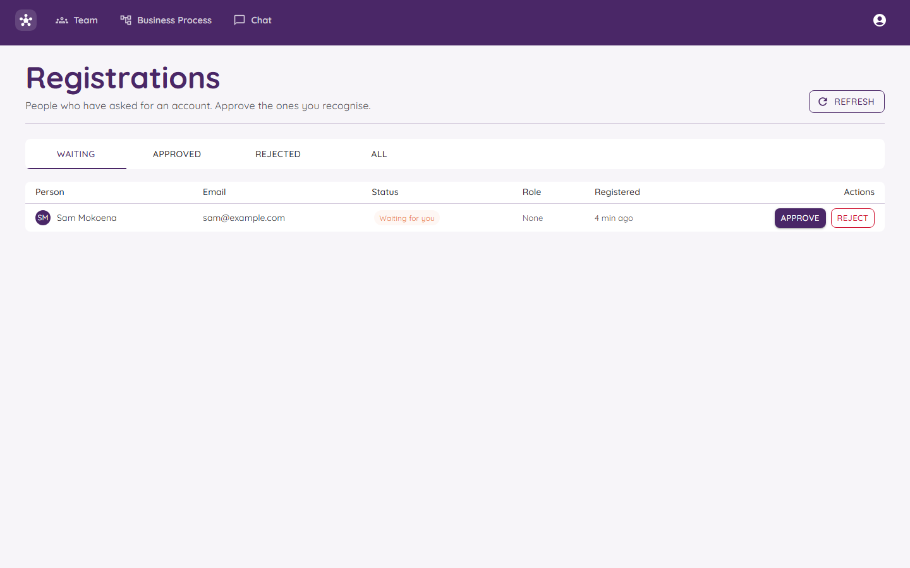

# Approving New People

This page is for **admins**. When someone creates an account, you decide if they get in.

## Where to find it

Click the round person icon at the top right and choose **Registrations**. Only admins see this item. A small badge on it tells you how many people are waiting.

## The tabs

| Tab | Who is in it |
|---|---|
| **Waiting** | People who asked for an account and are waiting for you. |
| **Approved** | People you let in. |
| **Rejected** | People you turned down. |
| **All** | Everyone. |

Press **Refresh** to check for new people.

## What each row shows

Name, email, status, role, and when they signed up. A person only shows up in **Waiting** after they have confirmed their email.

## Saying yes

1. Find the person in **Waiting**.
2. Choose a **role** for them. See [Roles and Permissions](Roles-and-Permissions.md).
3. Press **Approve**.

Orchestra sends the person an email to say they are in. A person gets **exactly one role**.

## Saying no

Press **Reject**. Any role they had is taken away. No email is sent to them.

## Be careful

- Only approve people you **recognise**. The page says so too.
- Give people the **smallest role** that lets them do their job. If they only need to read, make them a Viewer.
- You can come back later and change someone's role.

## Why two doors?

Remember that people go through two doors: they confirm their email, then you approve. The first door proves the email is really theirs. The second door is you making sure they belong. Together they stop strangers from walking in.

Back to [Signing In](Signing-In.md).
