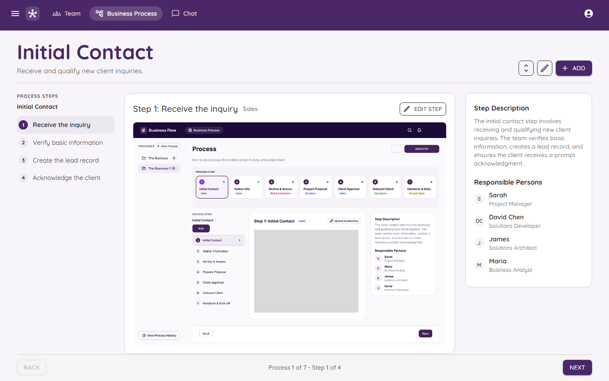
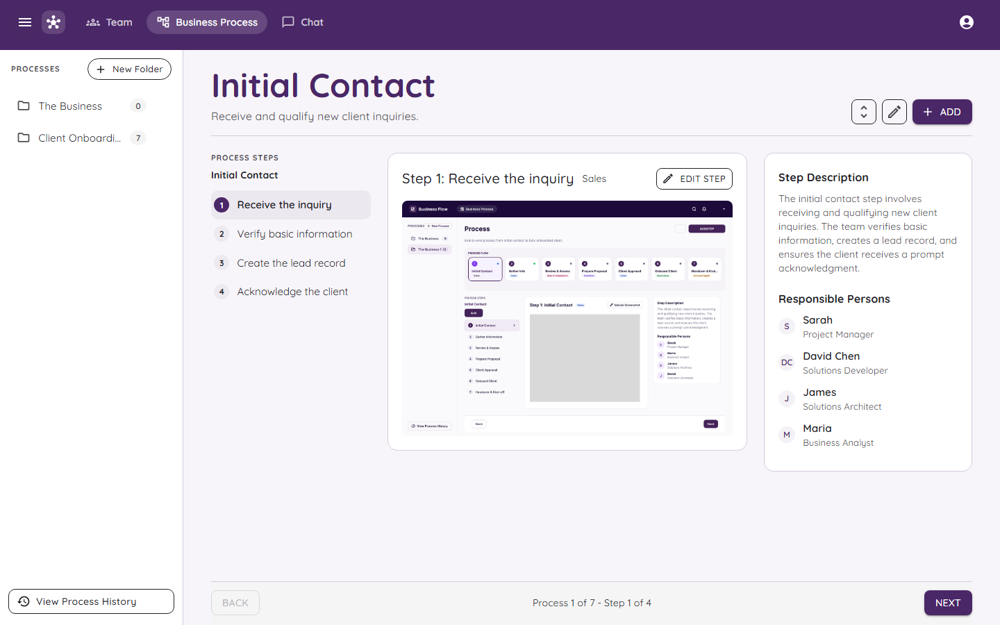
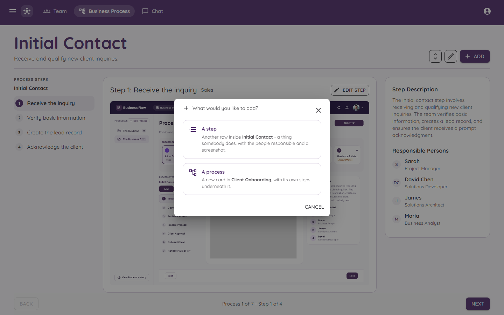
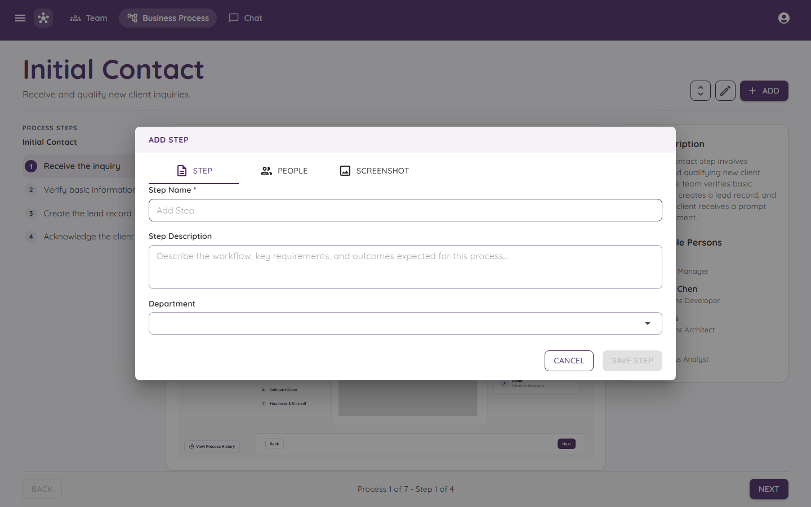
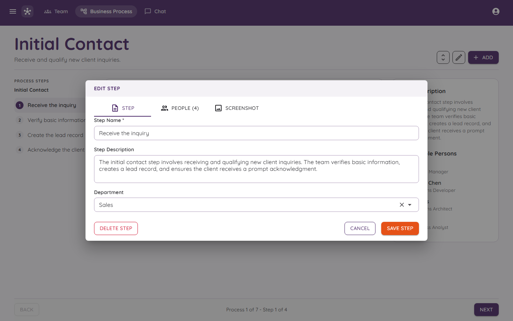
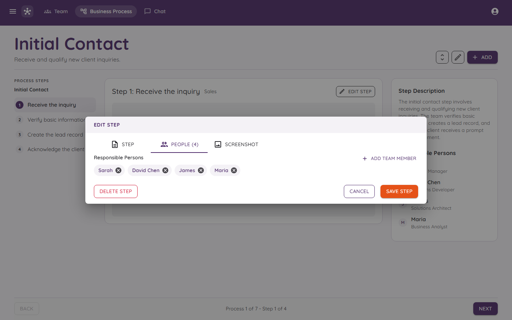
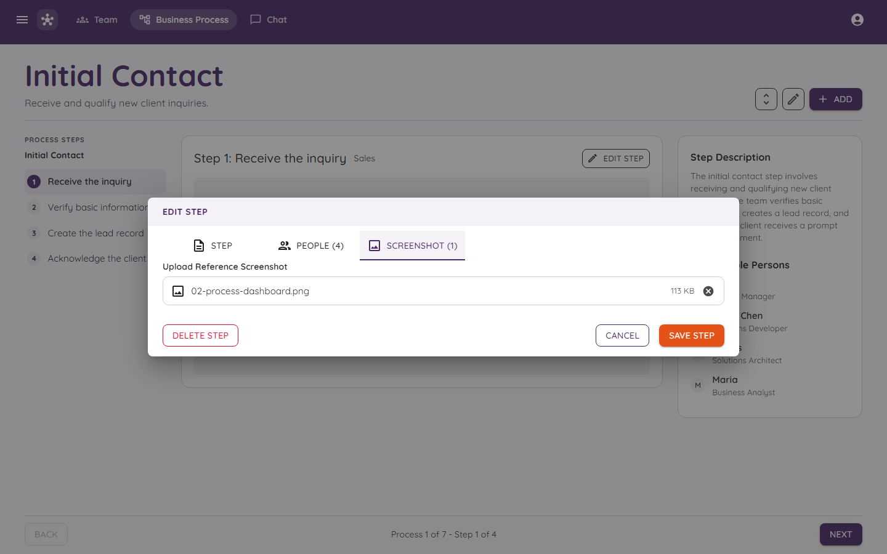
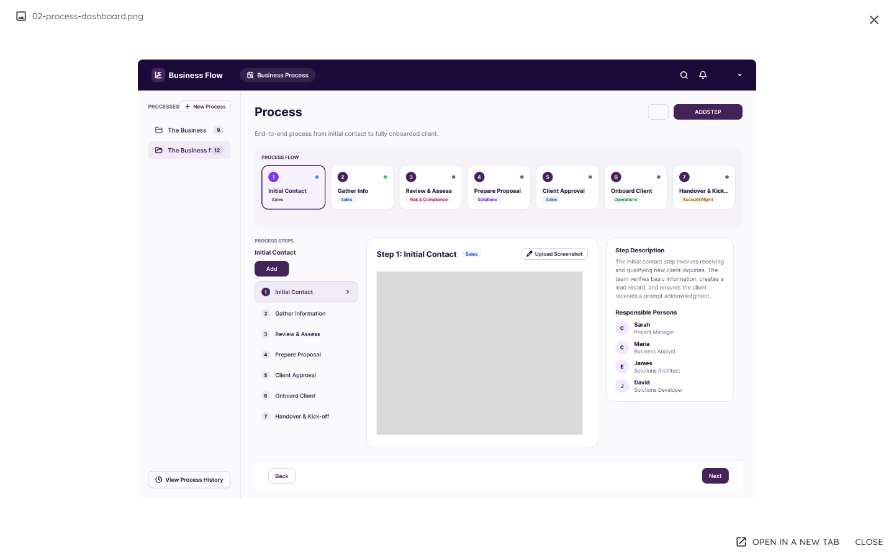

# Business Processes

This is the heart of Orchestra. It is where you write down **how the work is done**.

## The three levels

Think of a filing cabinet.

| Level | Like a... | Example |
|---|---|---|
| **Folder** | Drawer in the cabinet | Client Onboarding |
| **Process** | A recipe card in the drawer | Initial Contact |
| **Step** | One line in the recipe | Receive the inquiry |

So a folder holds processes, and a process holds steps in order.

## What is on the page

- **Top left:** the name of the process and a short line about it.
- **Top right:** three buttons. The up/down arrows change the order, the pencil edits the process, and **ADD** adds something new.
- **Left:** the list of steps, numbered in order.
- **Middle:** the step you picked, with its department and its screenshot.
- **Right:** the step description and the **Responsible Persons** (the people who do this step).
- **Bottom:** **Back** and **Next** buttons. They walk you through the steps one by one, and the middle says where you are, like "Process 1 of 7 - Step 1 of 4".

## Folders

Press the three-line menu button at the top left to open the folder list.

- Each folder shows how many processes it has.
- **New Folder** makes a new one.
- **View Process History** (at the bottom) shows who changed what and when.

## Adding something new

Press **ADD**. Orchestra asks what you want to add.

| Choice | What you get |
|---|---|
| **A step** | A new line inside the process you are looking at. |
| **A process** | A new card inside the folder, with its own steps under it. |

### Adding a step

The window has three tabs.

1. **Step:** a name (needed), a description, and a department.
2. **People:** choose the people who are responsible. You can pick more than one.
3. **Screenshot:** add a picture of the screen for this step.

Press **SAVE STEP**. The button stays grey until you have typed a name.

## Editing a step

On a step, press **EDIT STEP**. The same window opens with the step already filled in.

### Choosing the people

The number next to **PEOPLE** tells you how many are picked.

### Adding a screenshot

- Each step can have **one** screenshot.
- It must be a **PNG, JPG or WEBP** picture.
- It must be **5 MB or smaller**.
- Orchestra checks that the file really is a picture, not just a file with a picture name.

After you save, a "Step saved" message pops up and the picture appears in the middle.

### Looking at a screenshot big

Click the picture and it opens large.

You can open it in a new tab, or press **CLOSE** (or the X).

## Deleting and reordering

- **DELETE STEP** is a red button inside the edit window. Think twice before you press it.
- The up/down arrow button at the top lets you change the order.
- Only **Admins and Managers** can delete or reorder. See [Roles and Permissions](Roles-and-Permissions.md).

## Statuses

Steps have a status so everyone can see how things are going: **Not Started**, **In Progress**, **Complete** or **Blocked**.

## Tips for writing good steps

- Write one action per step. "Check the ID" is better than "Check everything".
- Say **who** does it. The bot will use that when someone asks "Who does this?"
- Add a screenshot when the step happens on a screen. It saves a hundred questions.
- Ask the bot about your step afterwards. If it cannot answer, the step needs more words. See [The Chat Bot](The-Chat-Bot.md).
