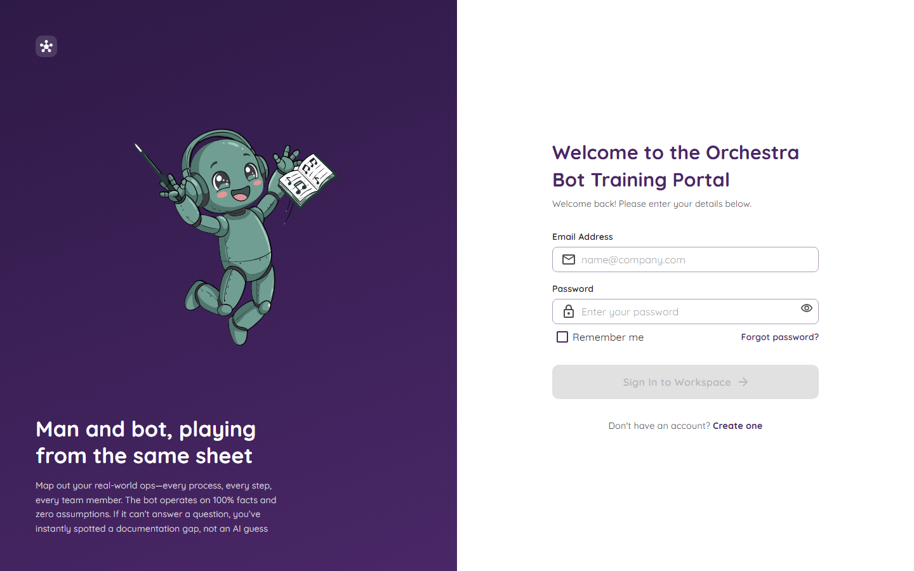

# Getting Started

This page shows you how to run Orchestra on your own computer. It takes about ten minutes.

## What you need first

| Thing | Why you need it |
|---|---|
| **.NET 9 SDK** | The tool that builds and runs the app. |
| **SQL Server LocalDB** | A small database that lives on your computer. It comes with Visual Studio. |
| **Git** | To download the code. |

## Run it

1. Open a terminal in the folder with the code (the one that has `TeamPortal.sln` in it).
2. Type this and press Enter:

```bash
dotnet run --project src/TeamPortal.Web
```

3. Wait until you see a line like `Now listening on: http://localhost:5211`.
4. Open that address in your browser.

The first time, the app makes its own database and fills it with a small **demo**: a folder called *Client Onboarding*, seven processes, some departments and a handful of staff. You do not have to set up anything by hand.

## Your first sign-in

The app makes one **administrator** for you. The email is in the settings file. The password is **not** in the settings file, because passwords must never be saved in a file that gets shared. You put it in a safe place called *user secrets*:

```bash
cd src/TeamPortal.Web
dotnet user-secrets set "SeedAdmin:Password" "pick-a-strong-password"
```

Pick a password with at least 10 characters, with a big letter, a small letter, a number and a symbol. Then start the app again and sign in.

More about this on [Settings and Secrets](Settings-and-Secrets.md).



## Turn on the chat bot

The bot works straight away with the built-in helper, called **Portal**. It needs no internet and no key. If you want a smarter AI later, see [The Chat Bot](The-Chat-Bot.md).

## If the database will not start

Sometimes LocalDB falls asleep. Wake it up:

```bash
sqllocaldb stop MSSQLLocalDB
sqllocaldb start MSSQLLocalDB
```

More fixes are on [Questions and Fixes](Questions-and-Fixes.md).

## Run the tests

```bash
dotnet test
```

There are hundreds of tests. They check that the real database version and the in-memory practice version behave the same way. You can read more on [How It Is Built](How-It-Is-Built.md).

## Next step

Go and have a look around: [The Home Page](The-Home-Page.md).
