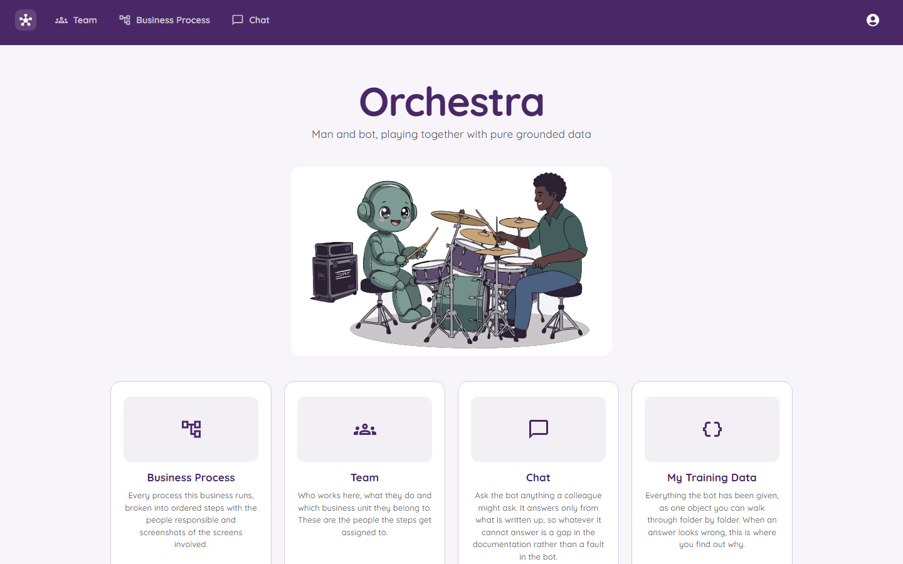

# Welcome to Orchestra

*Man and bot, playing together.*

## What is Orchestra?

Imagine a company where only one person knows how to do a certain job. That person goes on holiday, and nobody knows what to do. Orchestra fixes that.

Orchestra is a website where a business **writes down how its work is done**. Each job is written as a list of steps. Each step says **who is responsible** and can have a **screenshot** to show what the screen looks like.

Then there is a **chatbot**. You can ask it things like "What are the steps in Initial Contact?" It reads what was written down and answers. It does not guess. If the answer is not written down, it says so. That is useful, because it tells you which page still needs writing.

## The big idea in four words

**Write it. Ask it.**

## Who is it for?

- **Bosses and managers** who want the "how we do things" book in one place.
- **New staff** who want to learn a job without bothering everyone.
- **Anyone** who has ever asked "who does this step again?"

## Where do I start?

| I want to... | Go to |
|---|---|
| Get the app running on my computer | [Getting Started](Getting-Started.md) |
| Sign in or make an account | [Signing In](Signing-In.md) |
| Find my way around | [The Home Page](The-Home-Page.md) |
| Write down a process | [Business Processes](Business-Processes.md) |
| See who is on the team | [The Team](The-Team.md) |
| Ask the bot something | [The Chat Bot](The-Chat-Bot.md) |
| See exactly what the bot knows | [My Training Data](My-Training-Data.md) |
| Let new people in (admins) | [Approving New People](Approving-New-People.md) |
| Know who may do what | [Roles and Permissions](Roles-and-Permissions.md) |
| Change settings and passwords | [Settings and Secrets](Settings-and-Secrets.md) |
| Understand how it is built | [How It Is Built](How-It-Is-Built.md) |
| Look up a hard word | [Glossary](Glossary.md) |
| Fix a problem | [Questions and Fixes](Questions-and-Fixes.md) |

## A quick tour

1. You **sign in**. New people ask for an account, confirm their email, and wait for an admin to say yes.
2. On the **home page** you pick what to do: Business Process, Team, Chat, or My Training Data.
3. In **Business Process** you keep your folders, processes and steps.
4. In **Team** you keep the list of people and the departments they belong to.
5. In **Chat** you ask the bot questions. It answers from your steps.

## What is it made with?

Orchestra is a Blazor Server website on .NET 9, with a MudBlazor look and a SQL Server database. If those words are new to you, see the [Glossary](Glossary.md).

> Note: the product is called **Orchestra**, but inside the code the solution is still called `TeamPortal`. They are the same thing.
