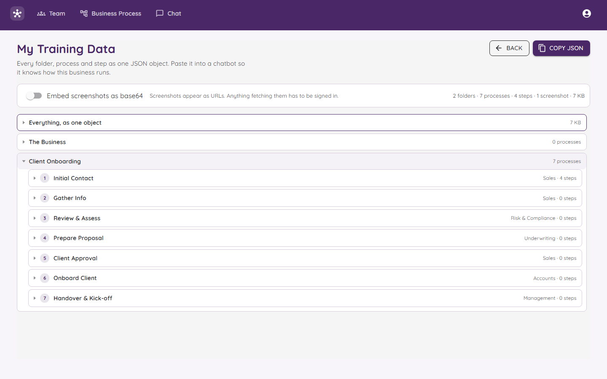

# My Training Data

"Training data" is a fancy name for **everything the bot has been told**.

## What is this page for?

When the bot gives a strange answer, you want to know why. This page shows you exactly what it was given. If it is not on this page, the bot does not know it.

## What you see

- A line at the top that counts things, like "2 folders, 7 processes, 4 steps, 1 screenshot".
- **Everything, as one object:** the whole record in one block, in a computer format called JSON.
- A list of your **folders**. Open one to see its processes, and open a process to see its steps.

## The buttons

| Button | What it does |
|---|---|
| **Copy JSON** | Copies everything so you can paste it somewhere else, like into another chatbot. |
| **Back** | Goes back to the chat. |
| **Embed screenshots as base64** | A switch. Off means pictures are shown as web addresses. On means the pictures are packed inside the text, which makes it much bigger. |

When the switch is off, any tool that wants to fetch a picture has to be signed in first. That keeps your screenshots private.

## A good habit

1. Ask the bot a question.
2. Did it get it wrong or say "not written up"?
3. Come here and look for the missing information.
4. Go and add it in [Business Processes](Business-Processes.md).
5. Ask again.

That is how you "train" the bot. You do not change the bot. You improve the writing.
