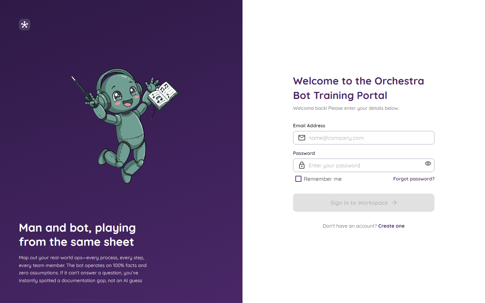
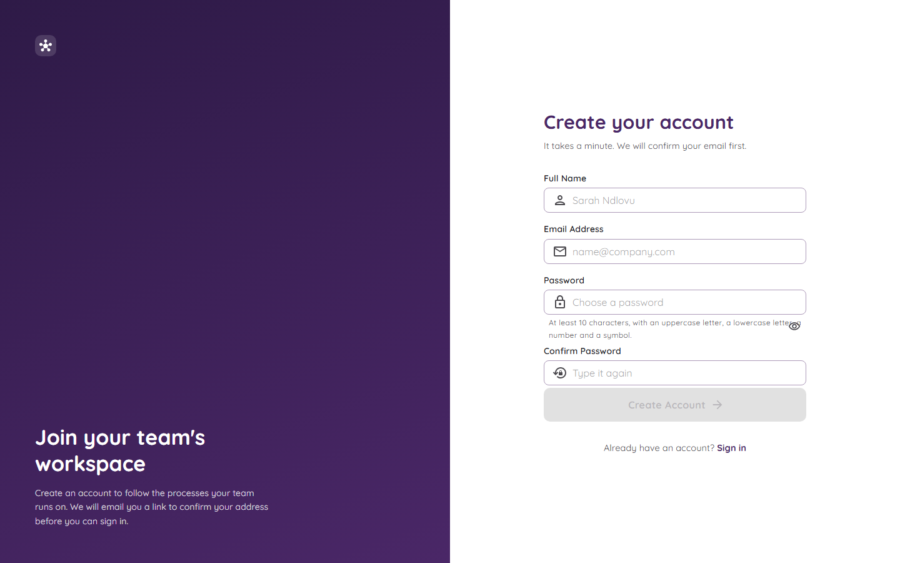
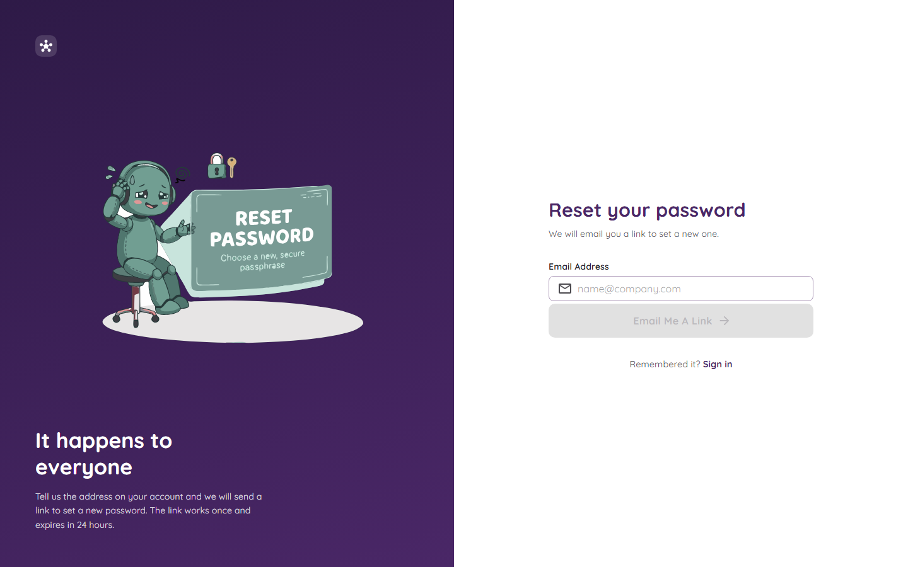

# Signing In

You need an account to use Orchestra. There are three screens for this: sign in, create an account, and forgot password.

## Sign in

1. Type your **email** and **password**.
2. Tick **Remember me** if you want to stay signed in on this computer.
3. Press **Sign In to Workspace**.

The button stays grey until both boxes are filled in properly.

### What if I type the wrong password?

- After **5 wrong tries** your account locks for **15 minutes**. This stops people from guessing your password.
- If you do not know whether the email exists, the page will not tell you. It gives the same answer for "wrong email" and "wrong password". That is on purpose, so strangers cannot find out who has an account.

### Why can't I get in even with the right password?

Orchestra checks four things, one after the other:

1. The password is right.
2. Your account is switched on.
3. You **confirmed your email**.
4. An **admin approved** you.

If one of these is missing, the page tells you which one.

## Create an account

1. On the sign-in page, press **Create one**.
2. Fill in your **full name**, **email**, and a **password** (typed twice).
3. Press **Create Account**.

Your password needs **at least 10 characters**, with a big letter, a small letter, a number and a symbol. For example, `Blue!Giraffe42` would work.

### What happens next

Two doors have to open before you can come in:

| Door | Who opens it | How |
|---|---|---|
| 1. Confirm your email | **You** | Click the link in the email we send you. |
| 2. Get approved | **An admin** | They see your name in a list and pick a role for you. See [Approving New People](Approving-New-People.md). |

Until both doors are open, you cannot sign in. Making an account never gives you access on its own.

## Forgot your password?

1. On the sign-in page, press **Forgot password?**
2. Type your email and send it.
3. Open the email and click the link. It works **once** and stops working after **24 hours**.
4. Choose a new password.

The page always says "done", even if the email is not in the system. Again, this keeps people's accounts private. Resetting your password also removes a lock if you were locked out.

## Signing out

Click the round person icon at the top right and choose **Sign out**. See [The Home Page](The-Home-Page.md).
