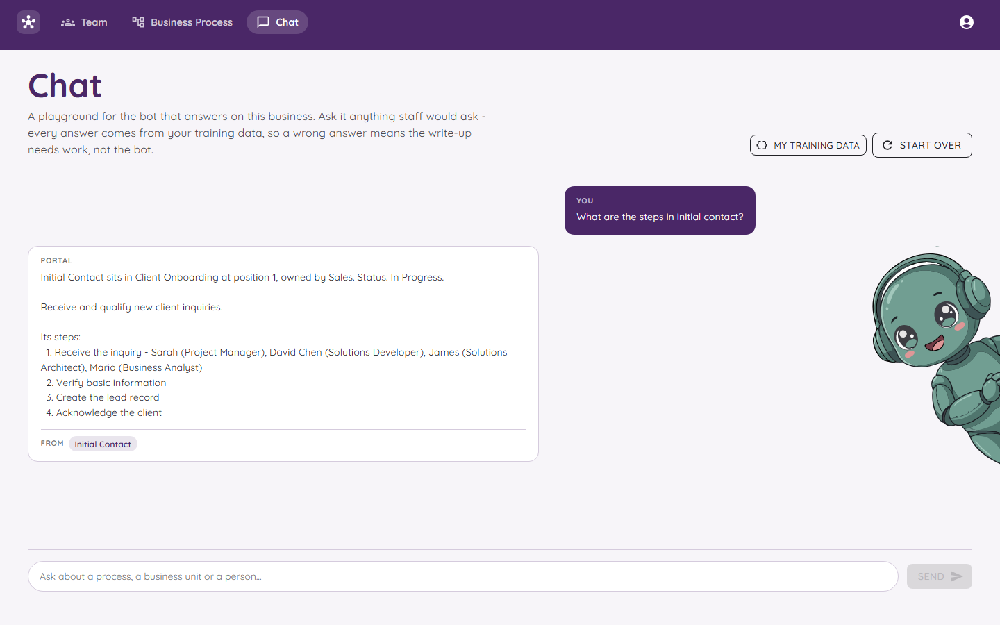

# The Chat Bot

The bot is the part of Orchestra that answers questions.

## The golden rule

**The bot only knows what is written in Orchestra.**

It does not look things up on the internet. It does not make things up to sound clever. If you ask something that is not written down, it tells you so.

That sounds like a weakness, but it is the best part. A wrong answer or an "I don't know" means the **writing** needs work, not the bot. Fix the page and ask again.

## How to use it

1. Press **Chat** in the top bar.
2. Type a question in the box at the bottom, or press one of the example questions.
3. Press **Send**.

Examples you can try with the demo data:

- What are the steps in initial contact?
- Who is responsible for preparing the proposal?
- Which processes does Sales own?
- Who is on the team and what do they do?
- Show me the screenshot for receiving an inquiry.

The answer shows a **From** tag. That tag tells you which process the answer came from, so you can go and check it yourself.

**Start Over** clears the conversation.

## Who does the answering?

Orchestra can use three different "brains". You choose in the settings with `Chat:Provider`.

| Brain | What it is | Needs a key? |
|---|---|---|
| **Portal** | The built-in helper. It searches your written steps and replies from them. | No |
| **Gemini** | A Google AI model. | Yes |
| **OpenAi** | An OpenAI model. | Yes |

**Portal** is the safest one to begin with. It cannot say anything that is not in the record.

### What if the AI breaks?

Even when you pick Gemini or OpenAI, the Portal helper stays on standby. If the key has run out, or the internet is down, Orchestra answers with Portal and adds a note saying so. The chat never just stops.

## What does the AI get to see?

The AI is given the same thing you can read on the [My Training Data](My-Training-Data.md) page. Nothing hidden. If an answer looks odd, that page is the first place to look.

## Using the bot on WhatsApp

Orchestra can also answer on WhatsApp, using a service called Twilio. It is **switched off** until you set it up. When it is off, the address just says "not found", so nobody can talk to it by accident. See [Settings and Secrets](Settings-and-Secrets.md).

Send the word **reset** to clear a conversation.

## Good questions and bad questions

| Good | Not so good |
|---|---|
| "Who owns the Review & Assess process?" | "What's the weather?" |
| "What comes after Verify basic information?" | "Tell me a joke." |

The bot is a worker, not a friend. It is there to answer questions about how your business runs.
