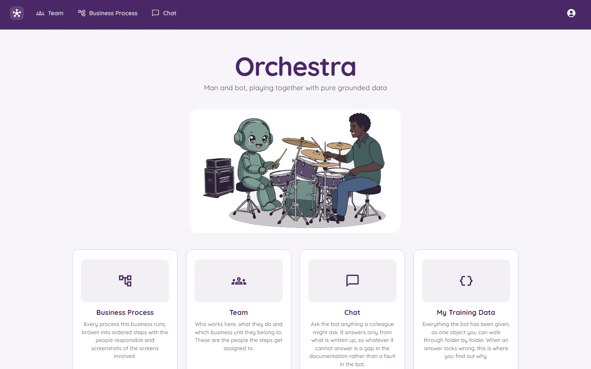
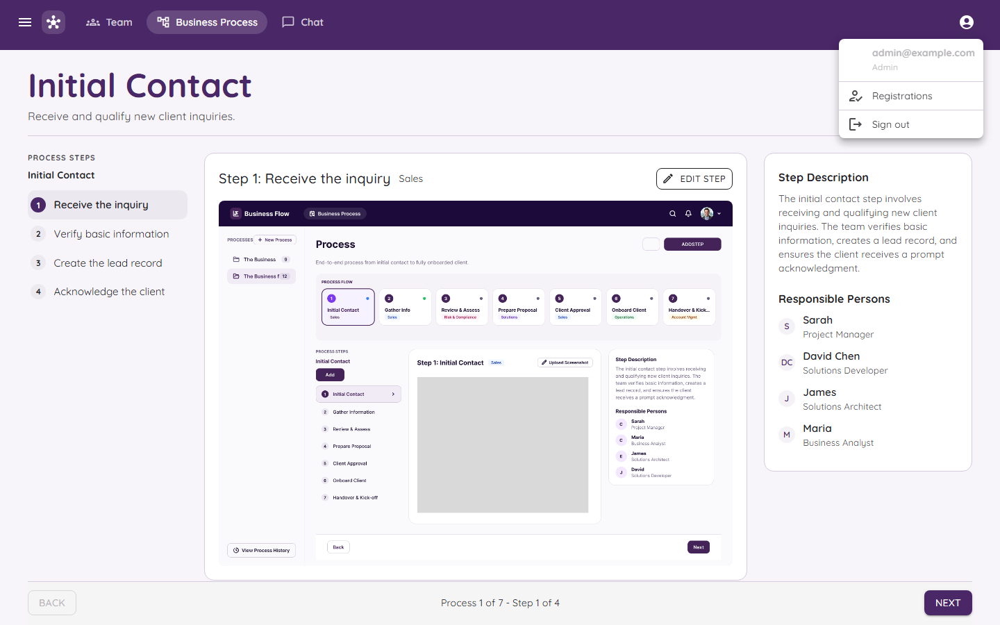

# The Home Page

After you sign in you land on the home page.

## The top bar

The purple bar at the top is on every page. It has:

| Item | What it does |
|---|---|
| The little logo | Takes you back to the home page. |
| **Team** | Goes to the list of people. See [The Team](The-Team.md). |
| **Business Process** | Goes to your folders, processes and steps. See [Business Processes](Business-Processes.md). |
| **Chat** | Opens the bot. See [The Chat Bot](The-Chat-Bot.md). |
| The round person icon | Opens your menu (see below). |

## The four big tiles

Scroll down on the home page and you will see four cards. Each one is a shortcut.

| Tile | What is inside |
|---|---|
| **Business Process** | Every process the business runs, split into ordered steps with the people responsible. |
| **Team** | Who works here, what they do and which department they belong to. |
| **Chat** | Ask the bot a question. It answers only from what is written down. |
| **My Training Data** | Everything the bot has been given, so you can check why it said something. See [My Training Data](My-Training-Data.md). |

## Your menu

Click the round person icon at the top right.

- Your **email** and **role** are shown at the top.
- **Registrations** shows up only for admins. It is the list of people waiting to be let in. See [Approving New People](Approving-New-People.md).
- **Sign out** ends your visit.

## Tips

- If a page is slow to react, wait a second. Orchestra keeps a live connection to the server. If that connection drops, a small box appears with buttons to try again.
- Pages you are not allowed to see send you back to the sign-in page.
