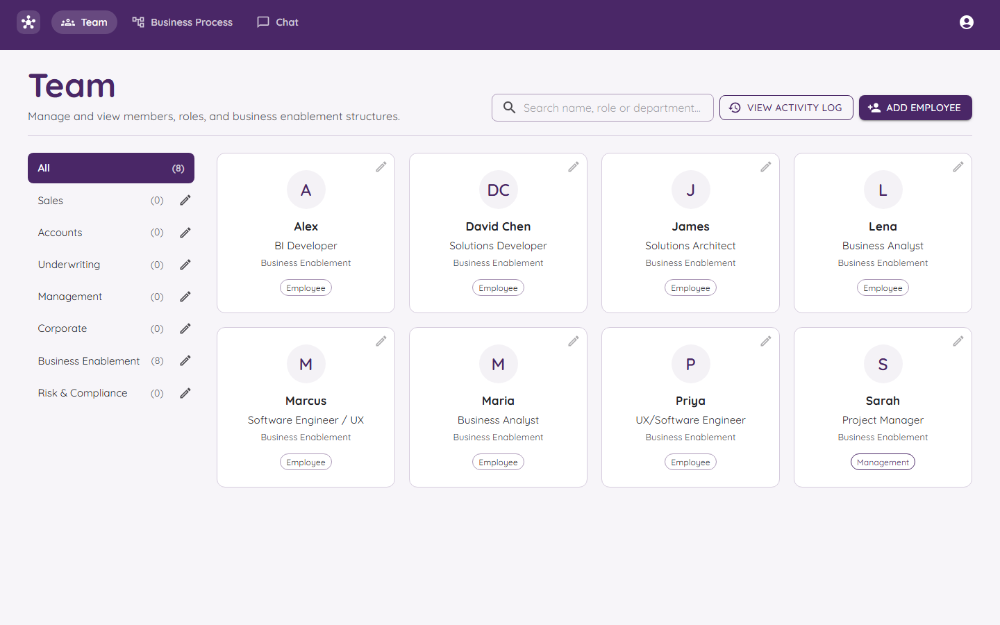
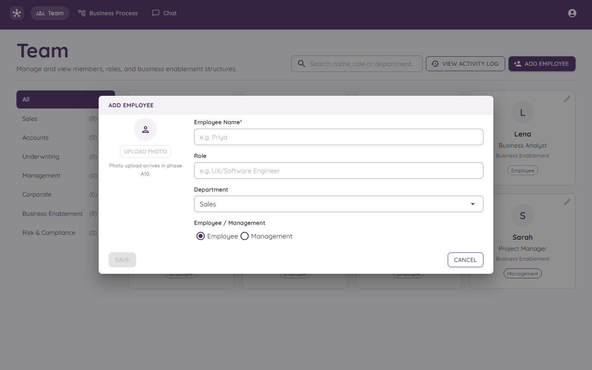
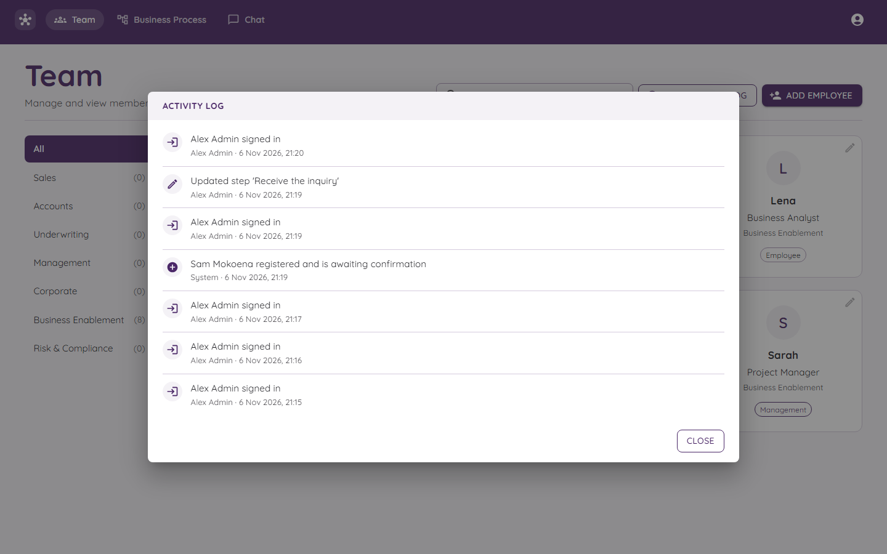

# The Team

The Team page is the phone book of your business. It shows who works there and which department they are in.

## What you see

- **Left:** a list of departments. The number in brackets is how many people are in each. **All** shows everyone.
- **Right:** a card for each person with their name, job, department and a small tag that says **Employee** or **Management**.
- **Top right:** a search box, **View Activity Log**, and **Add Employee**.

The pencil icon on a card edits that person. The pencil next to a department edits the department.

## Searching

Type in the search box. It looks at names, jobs and departments, so typing "sales" finds everyone in Sales.

## Adding a person

Press **ADD EMPLOYEE**.

| Box | What to type |
|---|---|
| **Employee Name** | Their name (needed). |
| **Role** | Their job, like "UX/Software Engineer". |
| **Department** | Pick one from the list. |
| **Employee / Management** | Pick which kind of person they are. |

Press **SAVE**.

> An *employee* here is a person who can be named on a step. It is **not** the same thing as a user account. A person can be listed here without ever signing in.

## Departments

Departments are the groups, like Sales, Accounts or Risk & Compliance. Each has a colour. That colour shows up on tags in other places, so people can spot a department quickly.

Use the pencil beside a department to change its name or colour.

## The activity log

Press **VIEW ACTIVITY LOG** to see a list of what happened and who did it.

Each line shows what happened, who did it, and when. Signing in shows up here, and so do changes to steps.

## Who can change things?

Everyone signed in can look. Only **Admins and Managers** can add, edit or delete people and departments. See [Roles and Permissions](Roles-and-Permissions.md).
